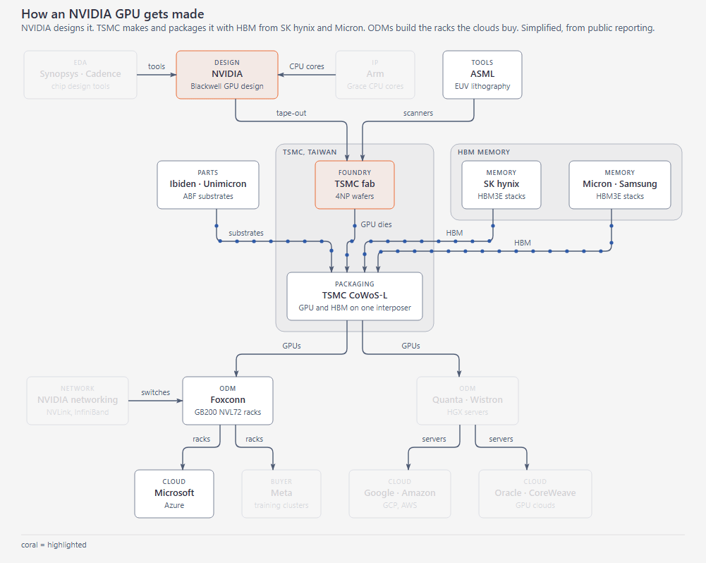
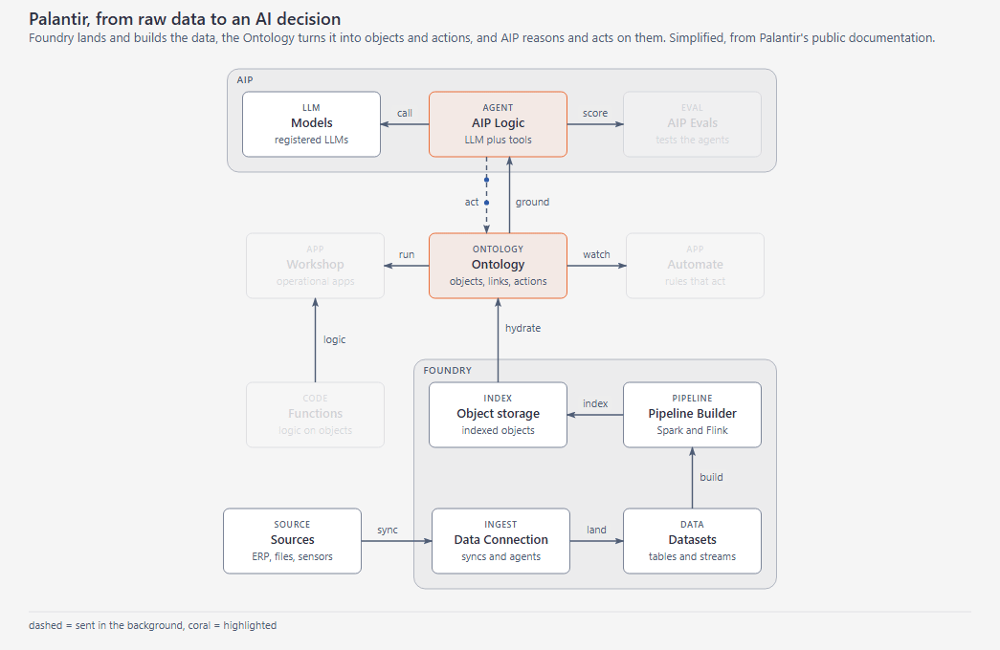
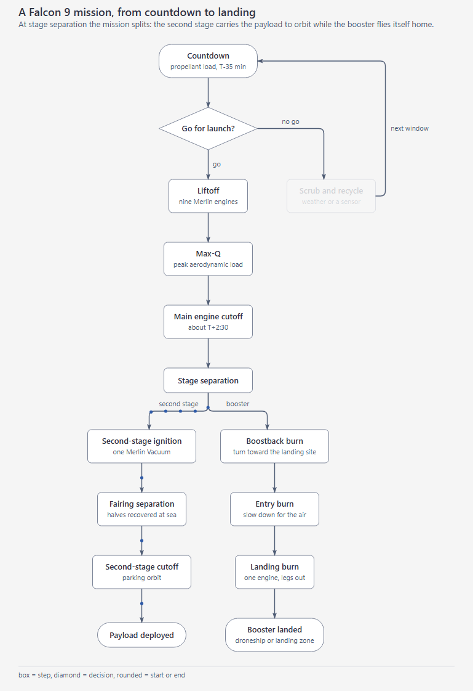
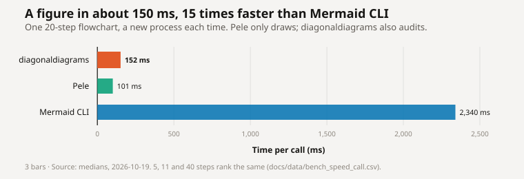
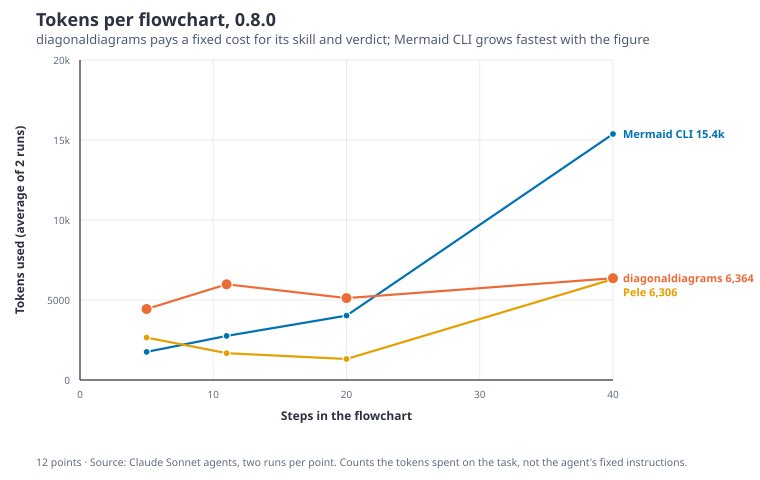
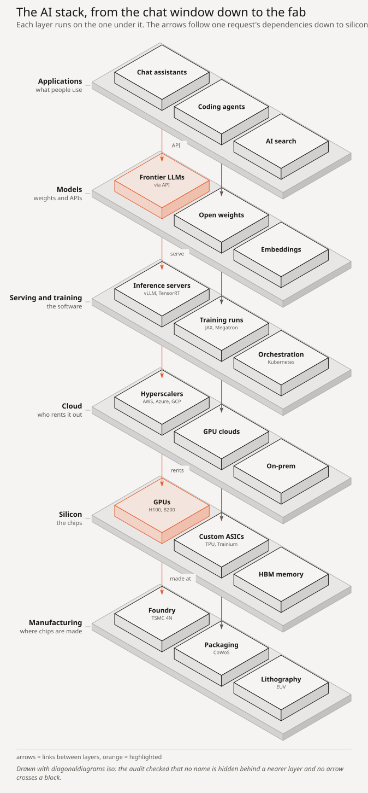

# diagonaldiagrams

Diagrams and charts an agent can draw, and check, before it shows you. One command takes Mermaid, a short JSON spec, or a CSV, lays it out, draws an SVG, and audits the drawing for labels on labels, arrows through boxes, and text that spills.

**[Try it in the browser](https://lucas19919.github.io/diagonaldiagrams/)**. The real engine, running in the page.

## Three figures

Each one passed its audit, then was filmed. The specs are in [`examples/showcase/`](examples/showcase).







## Quick start

Claude Code, as a plugin:

```text
/plugin marketplace add lucas19919/diagonaldiagrams
/plugin install diagonaldiagrams@diagonaldiagrams
```

Any agent, as a command:

```bash
pip install git+https://github.com/lucas19919/diagonaldiagrams
diagonaldiagrams mermaid flow.mmd -o out/flow.svg
```

The command prints one line of JSON. `ok: true` means the audit passed, and `layout` says what was drawn, so the agent can check the figure without a screenshot. `ok: false` comes with errors, each with a `fix`.

`--fit column` is the size for a README or a docs page. `slide`, the default, wraps a long flow for a deck. `page` is for print.

From a checkout, `py -3 graph.py` takes the same arguments. Agents install with [`.agents/skills/diagonaldiagrams-install/SKILL.md`](.agents/skills/diagonaldiagrams-install/SKILL.md) and draw with [`.agents/skills/graph-engine/SKILL.md`](.agents/skills/graph-engine/SKILL.md). The short version is [`llms.txt`](llms.txt).

## Measured

diagonaldiagrams 0.8.0 against [Mermaid CLI](https://github.com/mermaid-js/mermaid-cli) and [Pele](https://pele.run), on 2026-10-19. The same four flowcharts, 5, 11, 20 and 40 steps. The method is in [`bench/`](bench).

### Speed

Milliseconds for one figure, a new process each time. diagonaldiagrams was remeasured the same day: median of 7 calls, from bytecode ([`bench/speed/cli-2026-10-19.json`](bench/speed/cli-2026-10-19.json)). Pele and Mermaid CLI are that day's earlier run, not rerun.



| | 5 steps | 11 steps | 20 steps | 40 steps |
| --- | ---: | ---: | ---: | ---: |
| Pele, a new process | 95 | 104 | 101 | 107 |
| diagonaldiagrams | 136 | 142 | 152 | 154 |
| Mermaid CLI | 2,333 | 2,399 | 2,340 | 2,556 |

A diagonaldiagrams call is about 1.4 times a Pele process, and about 16 times faster than Mermaid CLI. Mermaid starts Node and a browser on every call. Pele only draws. diagonaldiagrams also audits the drawing and writes the page and the receipt.

### Tokens

Each point is a fresh Claude Sonnet agent with one prose task and nothing else. Two runs. Tokens are what the agent wrote, what came back, files it read, and screenshots. The harness and thinking are left out.



| Steps | diagonaldiagrams | Mermaid CLI | Pele |
| --- | ---: | ---: | ---: |
| 5 | 4.4k | 1.8k | 2.6k |
| 11 | 6.0k | 2.8k | 1.7k |
| 20 | 5.1k | 4.0k | 1.3k |
| 40 | 6.4k | 15.4k | 6.3k |

All eight runs:

| | Tokens | Calls | Screenshots | Time |
| --- | ---: | ---: | ---: | ---: |
| Pele | 23.9k | 57 | 18 | 5 min |
| diagonaldiagrams | 43.8k | 69 | 9 | 7 min |
| Mermaid CLI | 47.8k | 79 | 32 | 13 min |

Pele cost the least, because the model already knows Mermaid and reads no skill. diagonaldiagrams stays about the same at every size. Of its tokens, about 1.4k a run is reading the skill. Mermaid CLI grows fastest, and at 40 steps most of its tokens are screenshots of a figure several thousand pixels tall. Every one of the 24 figures passed this audit. Two runs is a small sample: single runs differed by up to 3.5 times.

An earlier run, on 0.5.0 (2026-10-04), had different prompts and is not comparable. It is in [`docs/data/bench_tools.csv`](docs/data/bench_tools.csv).

### Quality

Blind pairs. Two judges, both orders, two questions: which is clearer, and which looks better. The chart is the share diagonaldiagrams won on clarity; past the 50% line it won.


| | vs Pele | vs Mermaid |
| --- | ---: | ---: |
| On a slide, every figure | 85% (106/124) | 97% (120/124) |
| In a column, flows, each of 5, 11, 20, 40 steps | 100% (16/16) | 100% (16/16) |
| In a column, architecture we wrote | 75% (6/8) | 88% (7/8) |
| In a column, that architecture translated from Mermaid | 0% (0/8) | 50% (4/8) |

The column numbers are after `--fit column`, which keeps a README column near full-size text. The translated-architecture loss is one figure: the agent platform won 4 of 4 against Mermaid, and the checkout groups won none against either tool.

## Draw

| Command | Input | Draws |
| --- | --- | --- |
| `mermaid` | `flowchart`, `sequenceDiagram`, or `erDiagram` | A flow, a sequence, or a schema |
| `flow`, `arch`, `seq`, `schema` | JSON | The same four, from a spec |
| `iso` | JSON | A layer stack in isometric 3D: slabs, the blocks on them, links between layers |
| `bar`, `line`, `scatter` | CSV | A comparison, a trend, a relationship |
| `geo` | CSV or GeoJSON | Places on a built-in coastline |
| `chart <type>` | CSV or JSON | About 60 more |



`iso` draws a stack in true isometric. The audit reads its depth back from the SVG, and flags a name hidden behind a nearer layer, a name running off its block, a link crossing a block, and solids that run into each other. The spec is in [`examples/showcase/ai_stack.json`](examples/showcase/ai_stack.json).

`describe <type>` prints the contract. `diagonaldiagrams story SPEC.json -o out/story.html` walks through one figure. `--gif OUT.gif` films a view when ffmpeg is on the PATH. An edit is a JSON patch (`apply`), and `export OUT --to png|pdf|drawio|excalidraw` writes other formats.

## Tests

```bash
py -3 tests_smoke.py
py -3 scripts/golden.py
py -3 scripts/build_site.py
```

Exit 0 on the first is the contract an agent relies on. The second compares 115 figures. The third rebuilds the site, and refuses a figure that fails its audit. How the engine is put together, for contributors: [`docs/ARCHITECTURE.md`](docs/ARCHITECTURE.md).

## License

MIT. See [LICENSE](LICENSE).

<!-- mcp-name: io.github.lucas19919/diagonaldiagrams -->
